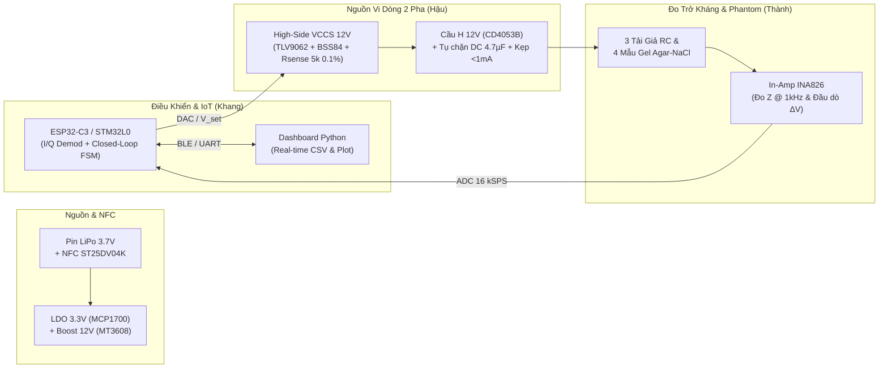

# Smart Wound Bandage — Băng Dán Vết Thương Thông Minh Dùng Vi Dòng

> **Đề tài Nghiên cứu Khoa học Sinh viên (HCMUT, 11/2026 – 05/2027):** Hệ thống băng dán thông minh kích thích vi dòng hai pha vòng kín — sử dụng các vi mạch thương mại (COTS) để **đo trở kháng thời gian thực** và **tự động điều chỉnh dòng nhằm giữ ổn định điện trường mục tiêu ($100 - 150\,\text{mV/mm}$)** hỗ trợ lành vết thương mạn tính.

---

## 1. Đội Hình Nghiên Cứu (Phân Công Theo Thế Mạnh)

| Thành viên | Chuyên ngành & Thế mạnh | Vai trò & Khối phụ trách chính | Tài liệu kỹ thuật trực tiếp |
| :--- | :--- | :--- | :--- |
| **Hậu** *(Vai C)* | **Thiết kế Vi mạch** (HCMUT) | **Mạch Kích Thích & PCB:** Nguồn dòng High-Side VCCS ($20-400\,\mu\text{A}$, nguồn $12\,\text{V}$), Cầu H chịu áp cao (`CD4053B`), cân bằng điện tích, giới hạn dòng phần cứng $<1\,\text{mA}$, quản lý nguồn & vẽ Schematic/Layout PCB KiCad. | [docs/hardware-architecture-and-bom.md](docs/hardware-architecture-and-bom.md) |
| **Thành** *(Vai A)* | **Thiết kế Vi mạch** + **Giải QG Sinh học** | **Sinh học – Điện hóa, Đo lường & Gel Phantom:** Cơ chế phân tử *electrotaxis* ($\text{PI3K}\gamma/\text{PTEN}$), mô hình Randles/Cole, mạch AFE đo trở kháng (`INA826`), chế tạo 3 tải giả RC & 4 mẫu Gel Agar–$\text{NaCl}$, bàn đo 4 điện cực ($E = \Delta V/d$) & giao thức In-vitro. | [docs/phantom-and-bio-experimental-protocol.md](docs/phantom-and-bio-experimental-protocol.md) |
| **Khang** *(Vai B)* | **IoT / Kỹ thuật Máy tính** (HCMUT) | **MCU Firmware, Vòng kín & IoT:** Lập trình MCU (`ESP32-C3`/`STM32`), giải điều chế đồng bộ I/Q tại $1\,\text{kHz}$, thuật toán vòng kín giữ điện trường ổn định, phát hiện bong điện cực, giao tiếp NFC (`ST25DV`)/BLE & phần mềm Dashboard Python. | [docs/closed-loop-algorithm-and-firmware.md](docs/closed-loop-algorithm-and-firmware.md) |

---

## 2. Động Lực Khoa Học & Điểm Mới Của Đề Tài

### 2.1. Tại sao dòng điện lại hỗ trợ chữa lành vết thương?
- Da nguyên vẹn hoạt động như một **"pin da" (skin battery)** với điện thế xuyên biểu bì $20-50\,\text{mV}$.
- Khi da bị rách, dòng ion rò qua vết thương tạo ra một **điện trường ngang nội sinh $\sim 100-200\,\text{mV/mm}$** hướng về tâm vết thương.
- Tế bào sừng (keratinocyte) và nguyên bào sợi (fibroblast) "đọc" điện trường này qua đường truyền tín hiệu $\text{PI3K}\gamma/\text{PTEN}$ và bò theo hướng điện trường (**electrotaxis**) để khép miệng vết thương.
- Ở **vết thương mạn tính** (loét tiểu đường, loét tì đè), điện trường tự nhiên bị suy yếu khiến vết thương kẹt ở pha viêm. Kích thích điện từ bên ngoài giúp tái lập "biển chỉ đường" đó.

### 2.2. Điểm mới cốt lõi: Định liều theo Điện trường (Electric-Field-Regulated Closed-Loop)
- Các mạch kích thích truyền thống đặt **biên độ dòng cố định ($I = \text{const}$)**. Khi vết thương chuyển từ trạng thái tiết nhiều dịch ($Z \approx 1.5\,\text{k}\Omega$) sang khô dần/đóng vảy ($Z \approx 20\,\text{k}\Omega$), việc giữ nguyên dòng $I$ làm **điện trường thực tế trong mô ($E = \rho \cdot J$) biến thiên hơn 10 lần**.
- **Giải pháp của nhóm:** Định kỳ đo trở kháng thực $R_{\text{wound}}$ bằng giải điều chế đồng bộ I/Q ở $1\,\text{kHz}$, từ đó tự động điều chỉnh biên độ dòng kích thích $I_{\text{stim}}[k]$ để giữ điện trường hiệu dụng luôn nằm trong cửa sổ sinh lý tối ưu ($120 \pm 15\,\text{mV/mm}$), đồng thời tự ngắt an toàn khi phát hiện bong/khô điện cực ($|Z| > 80\,\text{k}\Omega$).

---

## 3. Kiến Trúc Phần Cứng (Sử Dụng Chip Có Sẵn — COTS)



---

## 4. Danh Mục Tài Liệu Đầy Đủ Trong Repo

```text
smart-wound-bandage-ic/
├── README.md                                          # Tổng quan dự án, phân công đội hình & kiến trúc
└── docs/
    ├── Lich_NCKH_28_tuan_1_IoT_2_Vi_mach.xlsx         # Bảng Excel lịch 28 tuần chi tiết cho Thành, Khang, Hậu (16/11/2026 - 30/05/2027)
    ├── nckh-proposal-draft.md                         # Bản nháp Đề cương NCKH chuẩn HCMUT (dùng gặp GVHD ở Mốc 1)
    ├── hardware-architecture-and-bom.md               # Thiết kế mạch chi tiết, tính toán linh kiện & bảng BOM (~1,3 triệu VNĐ)
    ├── closed-loop-algorithm-and-firmware.md          # Toán học vòng kín giữ E ổn định, code C giải điều chế I/Q, FSM & chuẩn CSV
    ├── phantom-and-bio-experimental-protocol.md       # Công thức 3 tải giả RC, 4 mẫu Gel Agar-NaCl, bàn đo 4 cực & giao thức In-vitro
    ├── nckh-timeline-6-8-months.md                    # Tóm tắt lộ trình theo từng tháng (Tháng 1 -> Tháng 7-8)
    ├── theory-curriculum.md                           # Giáo trình lý thuyết nền tảng 8 module kèm câu hỏi tự kiểm tra
    ├── wound-bioelectricity-mechanism.md              # Giải thích trực quan cơ chế "pin da" và electrotaxis
    └── research-novelty-and-positioning.md            # Phân tích khoảng trống nghiên cứu so với bài báo Stanford 2023
```

---

## 5. Bốn Mốc Kiểm Soát Tiến Độ (Từ 16/11/2026 Đến 30/05/2027)

| Mốc | Thời điểm | Sản phẩm bàn giao bắt buộc |
| :--- | :--- | :--- |
| **MỐC 1** | **Tuần 6** *(Cuối tháng 12/2026)* | Đem bản đề cương [docs/nckh-proposal-draft.md](docs/nckh-proposal-draft.md) và sơ đồ khối gặp GVHD; chốt phạm vi đề tài. |
| **MỐC 2** | **Tuần 18** *(Giữa tháng 03/2027)* | Mạch nguồn dòng 2 pha + mạch đo `INA826` + MCU chạy thật trên **Breadboard** với 3 tải giả RC; có ảnh chụp sóng Oscilloscope. |
| **MỐC 3** | **Tuần 26** *(Giữa tháng 05/2027)* | **02 bo mạch PCB ($3 \times 4\,\text{cm}$)** hoàn chỉnh + Bộ dữ liệu đo đối chứng trên **4 mẫu Gel Phantom** ($n = 3$ lần lặp) giữa Open-loop và Closed-loop. |
| **MỐC 4** | **Tuần 28** *(Cuối tháng 05/2027)* | Hoàn tất **Quyển Báo cáo tổng kết NCKH**, **Video Demo 2 phút**, **Slide/Poster** và nộp hồ sơ đúng hạn. |

---

## 6. Nguyên Tắc An Toàn & Đạo Đức Nghiên Cứu
- Toàn bộ quá trình phát triển và đo đạc trong 28 tuần chỉ thực hiện trên **mạng tải giả RC** và **mô hình vết thương giả bằng Gel Agar – $\text{NaCl}$**, tuyệt đối không thử nghiệm trên người hoặc động vật.
- Thiết kế phần cứng tích hợp 3 lớp bảo vệ độc lập: xung hai pha cân bằng điện tích, tụ chặn dòng một chiều ($4.7\,\mu\text{F}$) + khóa xả thụ động, và mạch giới hạn dòng phần cứng $< 1\,\text{mA}$ tham chiếu tiêu chuẩn **IEC 60601-1** & **IEC 60601-2-10**.
