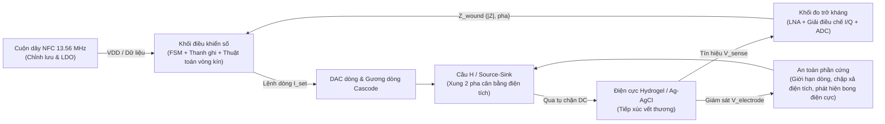

# Smart Wound Bandage IC — Băng dán vết thương thông minh dùng vi dòng

> **Đề tài nghiên cứu khoa học & Thiết kế Vi mạch (HCMUT):** Hệ thống kích thích điện vòng kín cho vết thương mạn tính — điều chỉnh liều theo **điện trường** dựa trên phép đo trở kháng thời gian thực, hướng tới tích hợp trên vi mạch (ASIC) công suất cực thấp và cấp nguồn không dây (NFC).

---

## 1. Động lực & Ý tưởng cốt lõi

### Tại sao dòng điện lại hỗ trợ lành vết thương?
- Da bình thường hoạt động như một **"pin da" (skin battery)** với hiệu điện thế xuyên biểu bì ~20–50 mV.
- Khi bị thương, lớp vỏ cách điện bị phá vỡ, dòng ion rò ra tạo một **điện trường ngang tự nhiên ~100–200 mV/mm** hướng về tâm vết thương.
- Tế bào da (keratinocyte), nguyên bào sợi (fibroblast) và đại thực bào di chuyển có hướng theo điện trường này (**electrotaxis**) để khép miệng vết thương.
- Ở **vết thương mạn tính** (loét tiểu đường, loét tì đè), tín hiệu điện tự nhiên này bị suy yếu hoặc tắt, khiến vết thương kẹt ở giai đoạn viêm. Kích thích điện từ bên ngoài giúp khôi phục lại điện trường dẫn đường đó.

### Điểm mới của đề tài (Research Gap & Novelty)
Các hệ thống kích thích điện hiện nay (kể cả băng dán thông minh FPCB của nhóm Stanford đăng trên *Nature Biotechnology* 2023) chủ yếu:
1. Đặt **dòng điện cố định** (ví dụ 100 µA), trong khi trở kháng vết thương thay đổi liên tục theo ngày (ẩm, khô, nhiễm trùng, lên da non) → **điện trường thực tế trong mô bị trôi** theo thời gian.
2. Dùng nhiều IC rời thương mại ghép trên mạch in dẻo (FPCB).

**Định hướng đóng góp của dự án:**
1. **Định liều theo điện trường (Electric-Field-Regulated Closed-Loop):** Đo trở kháng mô theo thời gian thực để tự động điều chỉnh biên độ dòng kích thích, giữ **điện trường mục tiêu** ổn định bất chấp sự thay đổi của trở kháng vết thương.
2. **Tích hợp lên vi mạch (Custom Stimulator + EIS ASIC):** Gộp khối tạo xung hai pha cân bằng điện tích, khối đo trở kháng (I/Q hoặc EIS), mạch giám sát an toàn và giao tiếp/cấp nguồn không dây (NFC) lên một con chip CMOS công suất thấp.
3. **Mở rộng (Đồ án tốt nghiệp):** Mảng nhiều điện cực để vẽ bản đồ trở kháng không gian và **lái hướng điện trường (electric field steering)** về phía mép vết thương đang lành chậm.

---

## 2. Kiến trúc hệ thống (System Architecture)



---

## 3. Cấu trúc tài liệu trong Repo

```text
smart-wound-bandage-ic/
├── README.md                                  # Tổng quan dự án, kiến trúc & lộ trình
└── docs/
    ├── theory-curriculum.md                   # Giáo trình lý thuyết 8 module (từ sinh học da đến IC & NFC)
    ├── wound-bioelectricity-mechanism.md      # Giải thích cơ chế điện sinh học của vết thương
    └── research-novelty-and-positioning.md    # Phân tích khoảng trống nghiên cứu & hướng điểm mới
```

---

## 4. Lộ trình thực hiện (Chia chặng cho sinh viên Thiết kế Vi mạch)

| Giai đoạn | Mục tiêu | Công cụ chính | Kiểm chứng |
| :--- | :--- | :--- | :--- |
| **Chặng 1 (Năm 2)** | Nắm lý thuyết 8 module; làm mạch rời nguồn dòng 2 pha + đo trở kháng + thuật toán giữ điện trường ổn định | LTspice, Breadboard/PCB, MCU | Đo trên **tải giả (mô hình Randles + RC da)** và **mô hình gel/nước muối (phantom)** |
| **Chặng 2 (Năm 3)** | Thiết kế các khối Analog/Mixed-Signal cấp transistor, mô phỏng PVT & Monte Carlo, vẽ layout DRC/LVS | Xschem, ngspice, Magic/KLayout, PDK SKY130 / GF180 | Hậu mô phỏng (Post-layout simulation) |
| **Chặng 3 (Năm 3–4 / ĐATN)** | Tích hợp hoàn chỉnh hệ thống vòng kín / mảng đa điện cực; thử nghiệm gửi tape-out qua shuttle mã nguồn mở | IIC-OSIC-TOOLS, Tiny Tapeout (wafer.space / IHP) | Đo đạc thực tế trên chip hoặc hệ lai |

---

## 5. Lưu ý an toàn & Đạo đức nghiên cứu
- Giai đoạn phát triển phần cứng **chỉ kiểm thử trên tải giả (dummy load) và mô hình gel (phantom)**, tuyệt đối không tự ý thử nghiệm lên người hoặc động vật khi chưa có sự phê duyệt của Hội đồng Đạo đức và giảng viên hướng dẫn.
- Mọi thiết kế kích thích điện tiếp xúc da cần tuân thủ nguyên tắc cân bằng điện tích (charge balancing) và tham chiếu tiêu chuẩn **IEC 60601-1** & **IEC 60601-2-10**.
