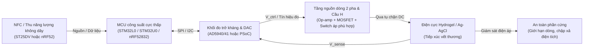

# Smart Wound Bandage — Băng dán vết thương thông minh dùng vi dòng

> **Đề tài nghiên cứu khoa học (HCMUT):** Hệ thống kích thích điện vòng kín cho vết thương mạn tính — sử dụng các vi mạch tích hợp sẵn (COTS) trên mạch in nhỏ gọn/dẻo để **đo trở kháng thời gian thực** và **tự động điều chỉnh dòng giữ điện trường ổn định**, hướng tới cấp nguồn không dây qua NFC.

---

## 1. Động lực & Ý tưởng cốt lõi

### Tại sao dòng điện lại hỗ trợ chữa lành vết thương?
- Da bình thường hoạt động như một **"pin da" (skin battery)** với hiệu điện thế xuyên biểu bì ~20–50 mV.
- Khi bị thương, lớp vỏ cách điện bị phá vỡ, dòng ion rò ra tạo một **điện trường ngang tự nhiên ~100–200 mV/mm** hướng về tâm vết thương.
- Tế bào da (keratinocyte), nguyên bào sợi (fibroblast) và đại thực bào di chuyển có hướng theo điện trường này (**electrotaxis**) để khép miệng vết thương.
- Ở **vết thương mạn tính** (loét tiểu đường, loét tì đè), tín hiệu điện tự nhiên này bị suy yếu hoặc tắt, khiến vết thương kẹt ở giai đoạn viêm. Kích thích điện từ bên ngoài giúp khôi phục lại điện trường dẫn đường đó.

### Điểm mới của đề tài (Research Gap & Novelty)
Các thiết bị kích thích điện hiện nay chủ yếu đặt **dòng điện cố định** (ví dụ 100 µA). Tuy nhiên, trở kháng vết thương thay đổi liên tục theo ngày (ẩm, khô, nhiễm trùng, lên da non) khiến **điện trường thực tế trong mô bị trôi** theo thời gian.

**Định hướng đóng góp của dự án:**
1. **Định liều theo điện trường (Electric-Field-Regulated Closed-Loop):** Đo trở kháng mô theo thời gian thực để tự động điều chỉnh biên độ dòng kích thích, giữ **điện trường mục tiêu** ổn định bất chấp sự thay đổi của trở kháng vết thương.
2. **Thiết kế hệ thống nhỏ gọn dùng chip có sẵn (COTS Hardware Integration):** Kết hợp MCU công suất thấp, chip đo trở kháng sinh học (AFE) / nguồn dòng chính xác, và NFC không dây trên một bo mạch nhỏ gọn (hướng tới FPCB).
3. **Hướng mở rộng chuyên sâu:** Tự phát hiện khô/bong điện cực qua trở kháng; mở rộng sang mảng nhiều điện cực để lập bản đồ trở kháng và **lái hướng điện trường (electric field steering)**.

---

## 2. Kiến trúc phần cứng đề xuất (Dùng chip có sẵn)



### Lựa chọn linh kiện tham khảo
- **Phương án 1 (Tối ưu đo trở kháng):** `STM32L0/U0` (hoặc `nRF52832`) + `AD5940/AD5941` (AFE chuyên dụng đo trở kháng sinh học EIS) + tầng nguồn dòng ngoài.
- **Phương án 2 (Tối giản linh kiện):** `Infineon PSoC 4 / PSoC 6` (tích hợp sẵn Op-amp, DAC, ADC bên trong) + `ST25DV` (NFC tag/energy harvesting).

---

## 3. Cấu trúc tài liệu trong Repo

```text
smart-wound-bandage-ic/
├── README.md                                  # Tổng quan dự án, kiến trúc dùng chip có sẵn & lộ trình
└── docs/
    ├── theory-curriculum.md                   # Giáo trình lý thuyết 8 module (từ sinh học da đến mạch & NFC)
    ├── wound-bioelectricity-mechanism.md      # Giải thích cơ chế điện sinh học của vết thương
    ├── research-novelty-and-positioning.md    # Phân tích khoảng trống nghiên cứu & hướng điểm mới
    └── nckh-timeline-6-8-months.md            # Kế hoạch thực hiện 6-8 tháng làm sản phẩm nộp NCKH
```

---

## 4. Lộ trình thực hiện

| Giai đoạn | Mục tiêu | Công cụ chính | Kiểm chứng |
| :--- | :--- | :--- | :--- |
| **Giai đoạn 1 (Nền tảng & Mô phỏng)** | Nắm lý thuyết sinh học – điện hóa; mô phỏng nguồn dòng 2 pha + tải giả Randles/da | LTspice, Python | Kiểm chứng dòng ổn định & cân bằng điện tích trên mô phỏng |
| **Giai đoạn 2 (Nguyên mẫu Breadboard/PCB)** | Lắp mạch với MCU + AFE/Op-amp; viết thuật toán vòng kín đo trở kháng – chỉnh dòng | KiCad, STM32CubeIDE / Arduino | Đo trên **tải giả RC** và **mô hình gel/nước muối (phantom)** để chứng minh giữ ổn định điện trường |
| **Giai đoạn 3 (Tối ưu & Mở rộng)** | Thu nhỏ sang PCB dẻo (FPCB) + NFC; (tùy chọn năm 3–4) chọn 1 khối analog để thiết kế ở mức transistor | KiCad, Xschem/ngspice (nếu mở rộng IC) | Đánh giá công suất, sai số điện trường và độ an toàn |

---

## 5. Lưu ý an toàn & Đạo đức nghiên cứu
- Giai đoạn phát triển phần cứng **chỉ kiểm thử trên tải giả (dummy load) và mô hình gel (phantom)**, tuyệt đối không tự ý thử nghiệm lên người hoặc động vật khi chưa có sự phê duyệt của Hội đồng Đạo đức và giảng viên hướng dẫn.
- Mọi thiết kế kích thích điện tiếp xúc da cần tuân thủ nguyên tắc cân bằng điện tích (charge balancing) và tham chiếu tiêu chuẩn **IEC 60601-1** & **IEC 60601-2-10**.
