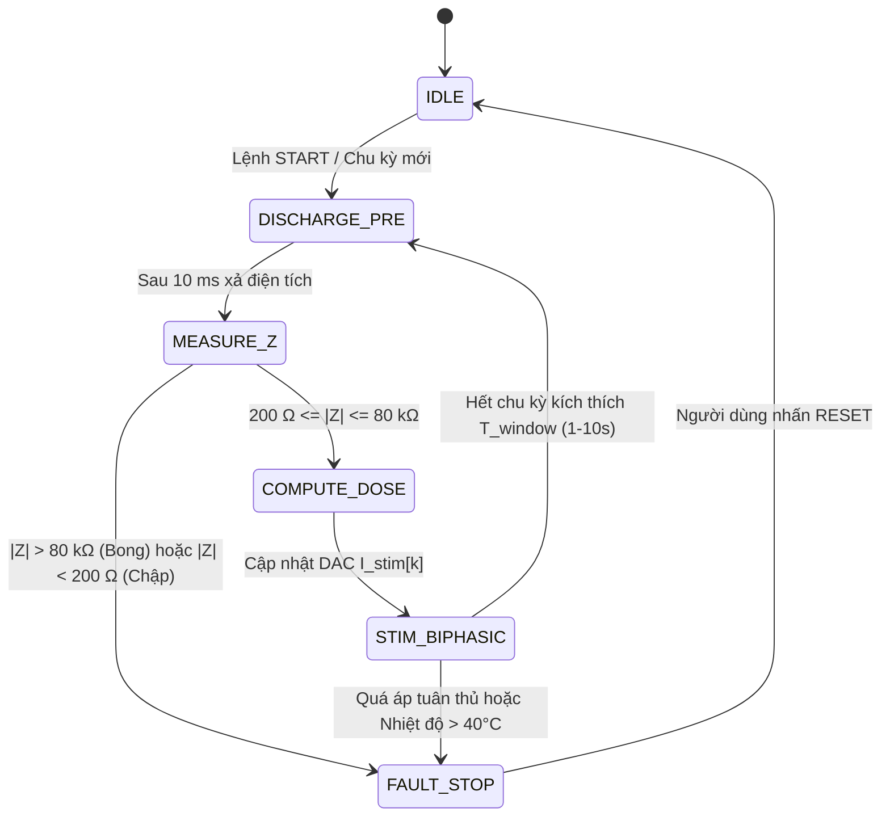

# Thuật Toán Điều Khiển Vòng Kín & Kiến Trúc Firmware

> **Phụ trách chính:** **Khang** (MCU Firmware, Giải điều chế I/Q, Thuật toán giữ ổn định điện trường & Dashboard)  
> **Phối hợp:** **Thành** (Hiệu chuẩn mô hình trở kháng $\leftrightarrow$ điện trường) & **Hậu** (Giao tiếp điều khiển DAC & Cầu H)

---

## 1. Bài Toán Điều Khiển Cốt Lõi (Điểm Mới Của Đề Tài)

### 1.1. Tại sao đặt dòng cố định ($I = \text{const}$) lại làm trôi điện trường?
Theo định luật Ohm dạng vi phân trong môi trường dẫn điện thể tích (mô vết thương hoặc gel phantom):
$$E = \frac{J}{\sigma} = \rho \cdot J$$
Với cấu hình 2 điện cực kích thích có hệ số hình học $k_g$ (đơn vị $\text{m}^{-1}$, xác định từ khoảng cách $d$ và diện tích tiếp xúc $S$, được hiệu chuẩn thực nghiệm trên khuôn phantom của Thành):
- Điện trở thuần của vùng mô vết thương ở tần số đặc trưng $f_0$ (ví dụ $f_0 = 1\,\text{kHz} - 10\,\text{kHz}$, nơi dung kháng lớp điện kép $C_{\text{dl}}$ đã giảm nhỏ):
  $$R_{\text{wound}} \approx \text{Re}\{Z(f_0)\} - R_{\text{contact}} = \frac{\rho}{k_g \cdot S}$$
- Điện trường ngang trung bình tại vùng giữa 2 điện cực tỉ lệ trực tiếp với **điện áp rơi trên phần mô vết thương**:
  $$E_{\text{est}} \approx \frac{I_{\text{stim}} \cdot R_{\text{wound}}}{d_{\text{eff}}}$$

> **Hệ quả:** Khi vết thương tiết nhiều dịch (trở kháng thấp, $R_{\text{wound}} = 1.5\,\text{k}\Omega$), dòng cố định $150\,\mu\text{A}$ chỉ tạo ra áp rơi $0.225\,\text{V}$. Nhưng khi vết thương khô dần hoặc đóng vảy ($R_{\text{wound}} = 15\,\text{k}\Omega$), cùng dòng $150\,\mu\text{A}$ lại tạo áp rơi $2.25\,\text{V}$ — **điện trường tăng gấp 10 lần!**

### 1.2. Luật điều khiển vòng kín ổn định điện trường (Electric-Field-Regulated Control Law)
Mục tiêu: Giữ điện trường hiệu dụng $E$ luôn bám theo giá trị đặt $E_{\text{target}} \in [100, 150]\,\text{mV/mm}$.

Tại mỗi chu kỳ đo $k$ (ví dụ mỗi $10\,\text{giây}$ trong thực tế, hoặc mỗi $1\,\text{giây}$ khi demo NCKH):
1. **Tạm dừng kích thích**, xả hết điện tích dư trong $10\,\text{ms}$.
2. **Đo trở kháng phức** tại tần số $f_0 = 1\,\text{kHz}$ (và tùy chọn $f_1 = 10\,\text{kHz}$ để tách ảnh hưởng tụ điện cực):
   $$Z(f_0) = R_{\text{meas}} + j X_{\text{meas}}, \qquad |Z| = \sqrt{R_{\text{meas}}^2 + X_{\text{meas}}^2}$$
3. **Kiểm tra an toàn điện cực (Fault Detection):**
   - Nếu $|Z| > Z_{\text{open}}$ (ví dụ $80\,\text{k}\Omega$): Báo lỗi **`ELECTRODE_DETACHED`** (bong/khô điện cực) $\to$ Ngắt kích thích ($I_{\text{stim}} = 0$).
   - Nếu $|Z| < Z_{\text{short}}$ (ví dụ $200\,\Omega$): Báo lỗi **`ELECTRODE_SHORT`** (ngắn mạch) $\to$ Ngắt kích thích.
4. **Tính dòng kích thích mục tiêu mới:**
   $$I_{\text{raw}}[k] = \frac{E_{\text{target}} \cdot d_{\text{eff}}}{R_{\text{meas}}[k]}$$
5. **Kẹp bảo vệ (Saturation / Safety Clamping) & Làm mượt (Low-pass Filter):**
   $$I_{\text{clamped}}[k] = \min\Big( I_{\max}, \; \max(I_{\min}, \; I_{\text{raw}}[k]) \Big), \quad \text{với } I_{\min} = 20\,\mu\text{A},\; I_{\max} = 400\,\mu\text{A}$$
   $$I_{\text{stim}}[k] = \alpha \cdot I_{\text{clamped}}[k] + (1 - \alpha) \cdot I_{\text{stim}}[k-1] \quad (\alpha = 0.3)$$

---

## 2. Giải Điều Chế Đồng Bộ I/Q Trên MCU (Dành Cho Phương Án B)

Khi MCU phát dòng thử hình sin $i(t) = I_{\text{test}} \sin(2\pi f_0 t)$ với $I_{\text{test}} = 10\,\mu\text{A}$ và lấy mẫu điện áp $v[n]$ ở tần số $f_s = N_s \cdot f_0$ (ví dụ $f_0 = 1\,\text{kHz}$, $f_s = 16\,\text{kHz} \Rightarrow N_s = 16$ mẫu/chu kỳ, lấy trong $M = 10$ chu kỳ $\to N = 160$ mẫu):

```c
// Bảng tra sin/cos tính sẵn cho 16 điểm/chu kỳ
void measure_impedance_iq(const float *v_samples, int N, float I_test,
                          float *R_out, float *X_out, float *Z_mag) {
    float sum_I = 0.0f, sum_Q = 0.0f;
    for (int n = 0; n < N; n++) {
        float angle = 2.0f * 3.14159265f * (n % 16) / 16.0f;
        sum_I += v_samples[n] * sinf(angle);
        sum_Q += v_samples[n] * cosf(angle);
    }
    float V_in_phase  = (2.0f / N) * sum_I; // Thành phần cùng pha (Thực)
    float V_quad      = (2.0f / N) * sum_Q; // Thành phần vuông pha (Ảo)

    *R_out = V_in_phase / I_test;
    *X_out = V_quad     / I_test;
    *Z_mag = sqrtf((*R_out) * (*R_out) + (*X_out) * (*X_out));
}
```

---

## 3. Máy Trạng Thái Hệ Thống (System Finite State Machine)



### Cấu trúc tạo xung 2 pha bằng Hardware Timer (tránh trôi thời gian do ngắt):
- **Pha 1 (Anodic/Cathodic):** Đóng cặp khóa $(S_1, S_4)$ trong $T_{\text{pulse}} = 2\,\text{ms} - 10\,\text{ms}$.
- **Nghỉ giữa pha (Inter-phase delay):** Ngắt toàn bộ cầu H trong $100\,\mu\text{s}$.
- **Pha 2 (Đảo chiều):** Đóng cặp khóa $(S_2, S_3)$ trong đúng $T_{\text{pulse}}$.
- **Xả thụ động (Passive discharge):** Đóng khóa chập 2 điện cực qua trở $1\,\text{k}\Omega$ trong $5\,\text{ms}$.

---

## 4. Chuẩn Gói Tin Telemetry Xuất Ra Máy Tính / Dashboard (CSV qua UART/BLE)

Để dễ vẽ đồ thị tự động bằng Python khi đo Gel Phantom ở Tuần 24–25, firmware của Khang xuất đúng định dạng CSV sau mỗi chu kỳ:

```text
timestamp_ms,mode,R_ohm,X_ohm,Z_mag_ohm,temp_C,I_set_uA,V_probe_mV,E_meas_mV_mm,fault_code
1000,CLOSED_LOOP,4850.2,-620.5,4889.7,28.4,247.4,1210.5,121.1,0
2000,CLOSED_LOOP,9720.8,-1105.0,9783.4,28.4,123.5,1198.2,119.8,0
```
- `mode`: `OPEN_LOOP` (giữ $I_{\text{set}}$ cố định) hoặc `CLOSED_LOOP` (tự động điều chỉnh $I_{\text{set}}$).
- `V_probe_mV` & `E_meas_mV_mm`: Điện áp thu từ 2 đầu dò đo điện trường cắm trong Gel Phantom (chỉ dùng trong bàn đo kiểm chứng phòng lab).
