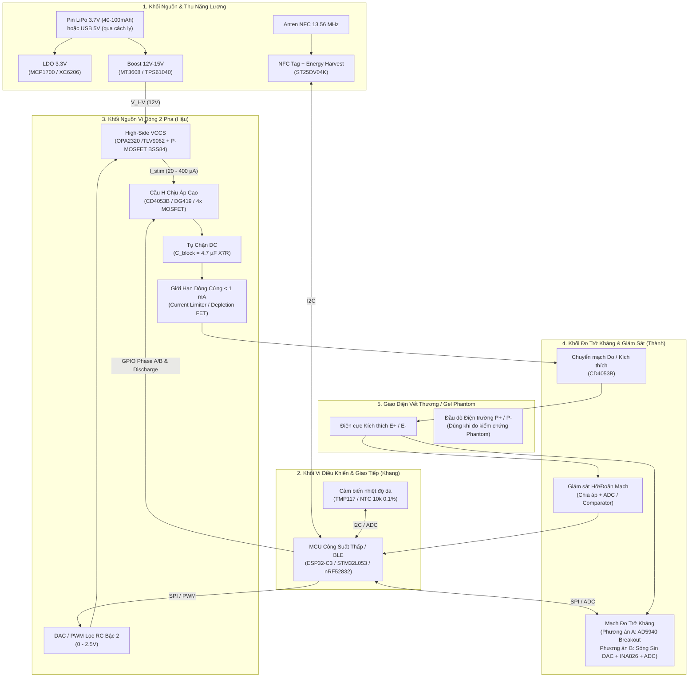

# Đặc Tả Phần Cứng & Danh Mục Linh Kiện (Hardware Architecture & BOM)

> **Phụ trách chính:** **Hậu** (Thiết kế Vi mạch — Mạch kích thích 2 pha, Nguồn, Bảo vệ & PCB KiCad)  
> **Phối hợp:** **Thành** (Mô hình tải, AFE đo trở kháng) & **Khang** (Giao tiếp MCU, NFC/BLE)

---

## 1. Sơ Đồ Khối Phần Cứng Chi Tiết (COTS Architecture)

---

## 2. Tính Toán Thiết Kế Từng Khối (Để Hậu Đưa Vào LTspice & KiCad)

### 2.1. Khối nguồn dòng không đổi (High-Side VCCS)
Sử dụng cấu trúc **Op-amp + P-MOSFET + Điện trở chuẩn $R_{\text{sense}}$** để không phụ thuộc vào sai số khớp cầu điện trở như mạch Howland:

- Điện áp điều khiển từ DAC (hoặc PWM lọc thông thấp 2 bậc): $V_{\text{set}} \in [0\,\text{V}, 2.5\,\text{V}]$.
- Dùng tầng dịch mức (NPN/MOSFET kênh N như `2N7002` + điện trở kéo lên $V_{\text{HV}}$) hoặc cấu trúc gương dòng để chuyển $V_{\text{set}}$ tham chiếu GND lên tham chiếu đường nguồn cao áp $V_{\text{HV}} = 12\,\text{V}$:
  $$I_{\text{stim}} = \frac{V_{\text{set}}}{R_{\text{sense}}}$$
- Chọn $R_{\text{sense}} = 5.0\,\text{k}\Omega$ (sai số $0.1\%$, hệ số nhiệt $\le 25\,\text{ppm}/^\circ\text{C}$):
  - Khi $V_{\text{set}} = 0.1\,\text{V} \Rightarrow I_{\text{stim}} = 20\,\mu\text{A}$.
  - Khi $V_{\text{set}} = 1.0\,\text{V} \Rightarrow I_{\text{stim}} = 200\,\mu\text{A}$.
  - Khi $V_{\text{set}} = 2.0\,\text{V} \Rightarrow I_{\text{stim}} = 400\,\mu\text{A}$.

### 2.2. Điện áp tuân thủ (Compliance Voltage) & Lưu ý chọn IC Cầu H
- Với dòng cực đại $I_{\max} = 400\,\mu\text{A}$ và trở kháng tải vết thương/điện cực lên tới $Z_{\max} = 25\,\text{k}\Omega$:
  $$V_{\text{load, max}} = 400\,\mu\text{A} \times 25\,\text{k}\Omega = 10\,\text{V}$$
- Do đó đường nguồn kích thích $V_{\text{HV}}$ được thiết kế ở mức **$12\,\text{V}$** (hoặc $15\,\text{V}$).
- **Cảnh báo quan trọng khi chọn IC Cầu H:**
  - Tuyệt đối **không dùng** các analog switch 5V (như `TS5A3159`, `ADG884`) ở tầng $12\,\text{V}$ vì sẽ đánh thủng chip.
  - **Giải pháp đúng, rẻ và sẵn có tại Việt Nam:** dùng IC chuyển mạch CMOS chịu áp tới $18-20\,\text{V}$ như **`CD4053BM`** (dòng rò pA, giá ~5.000đ, vỏ SOIC-16 dễ hàn) hoặc **`DG419` / `MAX4544`**, kết hợp transistor dịch mức lệnh điều khiển từ $3.3\,\text{V}$ của MCU lên $12\,\text{V}$.

### 2.3. Cân bằng điện tích (Charge Balancing) & An toàn phần cứng
1. **Xung hai pha đối xứng (Symmetric Biphasic):** Pha dương (Cathodic/Anodic) có độ rộng $T_{\text{pulse}}$ bằng đúng pha âm, cách nhau khoảng nghỉ ngắn $T_{\text{inter}} = 50-100\,\mu\text{s}$.
2. **Tụ chặn DC ($C_{\text{block}}$):** Mắc nối tiếp với điện cực một tụ gốm $4.7\,\mu\text{F} / 25\,\text{V}$ (X7R) để đảm bảo dòng trung bình một chiều qua mô luôn bằng $0$ ngay cả khi MCU bị treo.
3. **Khóa chập xả điện tích dư (Passive Charge Recovery Switch):** Sau mỗi chu kỳ xung 2 pha, MCU đóng khóa nối 2 điện cực qua điện trở $1\,\text{k}\Omega$ trong $2-5\,\text{ms}$ để triệt tiêu hoàn toàn điện áp tích tụ trên lớp điện kép $C_{\text{dl}}$.
4. **Giới hạn dòng phần cứng độc lập ($< 1\,\text{mA}$):** Mắc nối tiếp một cầu giới hạn dòng bằng JFET/Depletion MOSFET (hoặc BJT current limiter với 2 diode chuẩn) khóa cứng ở ngưỡng $750\,\mu\text{A} - 900\,\mu\text{A}$.

---

## 3. Hai Phương Án Cho Khối Đo Trở Kháng (Thành & Khang)

| Tiêu chí | Phương án A: Dùng module `AD5940` / `AD5933` | Phương án B: Tự dựng AFE bằng Op-amp + ADC MCU ⭐ (Khuyên dùng làm phương án chính/song song) |
| :--- | :--- | :--- |
| **Cấu tạo** | Chip chuyên dụng tích hợp sẵn DDS tạo sin, TIA, PGA, ADC 16-bit và khối DFT tính sẵn phần thực/ảo $(R, X)$ | MCU phát sóng sin nhỏ ($1\,\text{kHz}$, biên độ dòng $10\,\mu\text{A}_{\text{pk}}$) qua tải $\to$ Khuếch đại vi sai (`INA826`/`AD620`) $\to$ ADC 12-bit của MCU lấy mẫu $20\,\text{kSPS}$ $\to$ Giải điều chế I/Q bằng code C |
| **Ưu điểm** | Độ chính xác rất cao, quét được dải tần rộng | **Linh kiện cực dễ mua ở VN, chân to dễ hàn, hiểu sâu bản chất xử lý tín hiệu I/Q**, không sợ hỏng chip đắt tiền |
| **Cách triển khai** | Mua board breakout có sẵn cắm qua header SPI | Hàn trực tiếp lên bo PCB của nhóm |

---

## 4. Danh Mục Linh Kiện Dự Kiến (BOM Mua Tại Việt Nam — IC Đầy Đủ, Dễ Hàn)

| Nhóm | Linh kiện | Mã gợi ý (Part Number) | Kiểu chân | Số lượng (cho 3 bo) | Giá ước tính (VNĐ) |
| :--- | :--- | :--- | :--- | :---: | ---: |
| **MCU & IoT** | Vi điều khiển + BLE | `ESP32-C3-MINI-1` hoặc `STM32L053C8T6` / `STM32F103C8T6` | Module / LQFP-48 | 3 | 150.000 |
| **NFC** | NFC Dynamic Tag + Energy Harvest | `ST25DV04K-IER6C3` (hoặc module breakout ST25DV) | SOIC-8 / Module | 2 | 120.000 |
| **Nguồn** | IC Boost $3.7\,\text{V} \to 12\,\text{V}$ | `MT3608` (SOT23-6) hoặc `TPS61040DBVR` | SOT23-6 | 5 | 25.000 |
| **Nguồn** | LDO $3.3\,\text{V}$ nhiễu thấp | `MCP1700-3302E` hoặc `XC6206P332MR` | SOT23-3 | 5 | 20.000 |
| **Kích thích** | Op-amp Rail-to-Rail CMOS | `TLV9062IDR` hoặc `MCP6002-I/SN` | SOIC-8 | 5 | 40.000 |
| **Kích thích** | P-MOSFET & N-MOSFET tín hiệu | `BSS84` (P-ch, 50V) + `2N7002` (N-ch, 60V) | SOT-23 | 20 | 30.000 |
| **Cầu H & Mux** | Analog Switch chịu áp $18\,\text{V}$ | `CD4053BM` (Triple 2-channel) hoặc `DG419DY` | SOIC-16 / SOIC-8 | 6 | 45.000 |
| **Đo Z (PA B)** | Khuếch đại đo lường (In-Amp) | `INA826AIDR` hoặc `AD620ARZ` | SOIC-8 | 3 | 120.000 |
| **Đo Z (PA A)** | Chip đo trở kháng (Tùy chọn) | Module `AD5933` (I2C, dễ mua ở VN) hoặc `AD5940` | Module / SOIC-16 | 1 | 250.000 |
| **Cảm biến** | Cảm biến nhiệt độ tiếp xúc | `NTC 10k 3950 0.5%` (dây mỏng) hoặc `TMP117` | Đầu dò / WSON | 5 | 50.000 |
| **Thụ động** | Điện trở chuẩn $R_{\text{sense}}$ $0.1\%$, tụ X7R, cuộn cảm | $5.0\,\text{k}\Omega$, $1.0\,\text{k}\Omega$, $10\,\text{k}\Omega$ (0805) | SMD 0805 | 1 bộ | 100.000 |
| **PCB & Vật tư** | Gia công PCB FR4 mỏng $0.8\,\text{mm}$ + Agar, NaCl, Điện cực Ag/AgCl dán | JLCPCB / xưởng nội địa + Điện cực ECG/TENS dán | — | 5 bo + 1 bộ | 350.000 |
| **TỔNG CỘNG** | | | | | **~1.300.000 VNĐ** |
