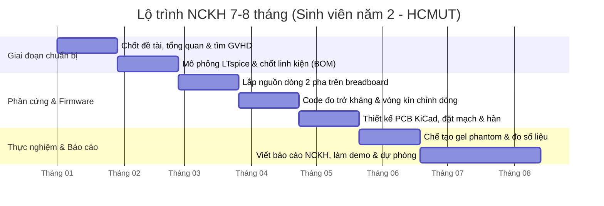

# Lộ trình 6–8 tháng làm sản phẩm nộp Nghiên cứu Khoa học (NCKH)

> **Mục tiêu cuối:** Có **bo mạch PCB hoàn chỉnh chạy vòng kín** + **dữ liệu đo đạc đối chứng trên mô hình gel (phantom)** + **báo cáo tổng kết NCKH** sẵn sàng nộp hội đồng vào tháng thứ 7–8.
> *Tháng thứ 8 được giữ làm quỹ dự phòng cho việc chờ linh kiện, sửa lỗi PCB vòng 2 hoặc đo lại số liệu.*

---

## Tổng quan tiến độ

---

## Chi tiết từng tháng

### Tháng 1: Chốt đề tài, tổng quan & tìm Giảng viên hướng dẫn (GVHD)
- **Học lý thuyết cốt lõi:** Tập trung M1 (lành vết thương) và M2 (điện trường nội sinh 100–200 mV/mm, electrotaxis). Đọc kỹ bài Stanford (*Nature Biotechnology* 2023) và Merrill (2005).
- **Viết đề cương 3–5 trang:** Nêu rõ bài toán, điểm mới (**giữ ổn định điện trường theo trở kháng thời gian thực**), phạm vi kiểm chứng (tải giả RC + gel phantom, chưa thử trên người).
- **Gặp GVHD:** Liên hệ thầy/cô ở Bộ môn Điện tử (HCMUT) để xin nhận hướng dẫn và đăng ký đề tài NCKH sinh viên theo đợt của trường/khoa.
- **Đầu ra:** Đề cương đã duyệt + sơ đồ khối hệ thống.

### Tháng 2: Mô phỏng mạch & chốt danh sách linh kiện (BOM)
- **Mô phỏng LTspice:** Dựng mạch nguồn dòng 2 pha (Op-amp + MOSFET/BJT + cầu H) kết hợp tải giả mô hình Randles + da. Kiểm tra dòng ổn định khi tải thay đổi từ $1\,\text{k}\Omega \to 50\,\text{k}\Omega$.
- **Chọn linh kiện thực tế (dễ mua, dễ hàn ở VN):**
  - *Mẹo cho năm 2:* Các chip như `AD5940` có chân rất nhỏ (LFCSP), khó hàn tay. Nên ưu tiên mua **module breakout có sẵn**, hoặc tự làm mạch đo trở kháng cơ bản bằng **DAC/PWM tạo sóng sin + ADC của STM32** để chủ động phần cứng.
  - Phiên bản đầu có thể dùng pin LiPo nhỏ / nguồn USB qua bộ cách ly an toàn để làm chạy vòng kín trước; NFC (`ST25DV`) bổ sung ở bản PCB nếu kịp tiến độ.
- **Đầu ra:** File mô phỏng LTspice chạy đạt thông số + bảng BOM đã đặt hàng.

### Tháng 3: Lắp nguyên mẫu trên breadboard & kiểm tra an toàn
- Lắp mạch nguồn dòng 2 pha, tụ chặn DC nối tiếp điện cực, và mạch giới hạn dòng phần cứng ($< 1\,\text{mA}$).
- Đo bằng oscilloscope trên **tải giả RC**: kiểm tra độ chính xác dòng (dải $10 - 300\,\mu\text{A}$), độ cân bằng 2 pha (điện áp DC dư $\approx 0$).
- **Đầu ra:** Nguyên mẫu breadboard chạy ổn định + ảnh chụp dạng sóng oscilloscope.

### Tháng 4: Lập trình thuật toán vòng kín (Closed-loop)
- Viết firmware trên MCU: định kỳ đo trở kháng tải $|Z|$ (và pha nếu có) → tính toán lại dòng đặt $I_{\text{stim}}$ để giữ điện áp/điện trường mục tiêu ổn định.
- Thêm tính năng phát hiện hở mạch / bong điện cực ($|Z|$ tăng vọt) để tự ngắt an toàn.
- **Đầu ra:** Hệ thống vòng kín hoàn chỉnh hoạt động trên tải giả thay đổi được.

### Tháng 5: Thiết kế & gia công PCB nhỏ gọn
- Vẽ Schematic và Layout PCB trên KiCad.
- *Khuyến nghị:* Bản đầu tiên nên đặt **PCB cứng FR4 mỏng (0.6–0.8 mm)** kích thước khoảng $3 \times 4\,\text{cm}$ để giá rẻ, dễ hàn sửa lỗi trước khi nghĩ đến mạch dẻo FPCB.
- Đặt 3–5 bo để dự phòng, hàn và kiểm tra lại toàn bộ bài test của Tháng 3–4 trên bo thật.
- **Đầu ra:** Bo mạch PCB hoàn chỉnh chạy đúng thiết kế.

### Tháng 6: Thực nghiệm trên mô hình vết thương giả (Gel Phantom)
- Pha **gel agar + muối NaCl** ở 3–4 nồng độ khác nhau để mô phỏng vết thương ở các trạng thái (ẩm/nhiễm dịch $\to$ khô dần/đang lành).
- Gắn 2 điện cực kích thích và 2 đầu dò đo điện thế trực tiếp trong gel để tính điện trường thực tế:
  $$E = \frac{\Delta V}{d}$$
- **Thực nghiệm đối chứng (dữ liệu ăn điểm của NCKH):** So sánh sai số của $E$ giữa 2 chế độ:
  1. **Dòng cố định (Open-loop)** — điện trường thay đổi mạnh theo nồng độ muối.
  2. **Điều chỉnh theo trở kháng (Closed-loop)** — điện trường được giữ ổn định quanh mức mục tiêu.
- **Đầu ra:** Bảng số liệu, đồ thị so sánh (ít nhất 3 lần lặp lại để tính trung bình & độ lệch chuẩn).

### Tháng 7–8: Hoàn thiện báo cáo NCKH, demo & quỹ dự phòng
- Viết báo cáo tổng kết: Tổng quan tài liệu $\to$ Cơ sở sinh học & điện hóa $\to$ Thiết kế phần cứng & thuật toán $\to$ Kết quả thực nghiệm trên tải giả & phantom $\to$ Đánh giá an toàn & hướng phát triển.
- Quay video demo hệ thống đang tự chỉnh dòng khi đổi mẫu gel + chuẩn bị slide bảo vệ.
- **Tháng 8** dùng làm quỹ dự phòng cho rủi ro thực tế (linh kiện về trễ, phải đặt lại PCB rev 2, hoặc cần đo bổ sung số liệu).
