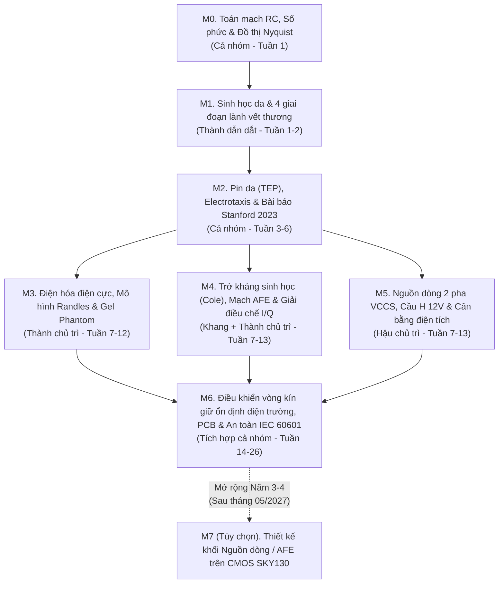

# Giáo Trình Lý Thuyết Trọng Tâm: Băng Dán Vết Thương Thông Minh Dùng Vi Dòng
*Biên soạn riêng cho nhóm NCKH HCMUT (11/2026 – 05/2027): **Hậu** – **Thành** – **Khang***

---

## 1. Cách Học Nhóm Để Tiết Kiệm Thời Gian Nhất (16/11/2026 – 30/05/2027)

Thay vì cả 3 người đều phải tự mò mọi thứ từ con số 0, giáo trình này chia thành **7 Module bắt buộc cho NCKH (M0 → M6)** và **1 Module mở rộng sau NCKH (M7 — Thiết kế IC mức transistor cho năm 3–4)**:

### Phân vai học tập trong nhóm

| Module | Ai đi sâu (Chủ trì giảng lại 15 phút) | Ai học nắm nguyên lý (Để ghép hệ thống) | Môn học liên quan tại HCMUT |
| :--- | :--- | :--- | :--- |
| **M0. Nền tảng mạch RC & Phức** | **Hậu & Thành** | **Khang** | Giải tích mạch, Tín hiệu & Hệ thống |
| **M1. Sinh học da & Vết thương** | **Thành** | **Hậu, Khang** *(chỉ học bản dịch sang mạch điện)* | Tự học có hướng dẫn của Thành |
| **M2. Pin da & Electrotaxis** | **Thành** (cơ chế) + **Hậu/Khang** (tính $E, J$) | Cả 3 cùng nắm chắc để bảo vệ đề cương | Vật lý điện từ + Sinh lý học |
| **M3. Điện hóa & Gel Phantom** | **Thành** | **Hậu** (để chọn tụ chặn DC), **Khang** (để hiểu ngưỡng lỗi) | Hóa đại cương + Vật liệu điện tử |
| **M4. Đo trở kháng & Thuật toán I/Q** | **Khang** (code I/Q) + **Thành** (mạch `INA826`) | **Hậu** (để phối hợp đóng/ngắt cầu H khi đo) | Xử lý tín hiệu số, Đo lường điện tử |
| **M5. Nguồn dòng 2 pha & Bảo vệ** | **Hậu** | **Thành** (kiểm tra chéo), **Khang** (điều khiển DAC/GPIO) | Mạch điện tử, Vi mạch tương tự |
| **M6. Vòng kín, PCB, NFC & An toàn** | **Hậu** (PCB) + **Khang** (Vòng kín/IoT) + **Thành** (An toàn/Phantom) | Cả 3 cùng tích hợp | Thiết kế hệ thống nhúng & PCB |

---

## M0. Nền Tảng Toán & Mạch Điện Cho Mô Hình Sinh Học ⭐ *(Tuần 1)*
> **Mục tiêu:** Đảm bảo Hậu, Thành, Khang nói chung một ngôn ngữ về số phức, đáp ứng xung RC và giản đồ Nyquist trước khi ghép với sinh học.

### 0.1. Kiến thức cốt lõi cần nắm
1. **Trở kháng phức và góc pha:**
   - Mọi mô sinh học và điện cực đều vừa cản dòng (điện trở $R$), vừa tích điện như tụ ($C$).
   - Tại tần số góc $\omega = 2\pi f$, dung kháng của tụ là $Z_C = \frac{1}{j\omega C} = -\frac{j}{\omega C}$.
   - Trở kháng tổng quát:
     $$Z(\omega) = R(\omega) + j X(\omega), \qquad |Z| = \sqrt{R^2 + X^2}, \qquad \phi = \arctan\left(\frac{X}{R}\right)$$
   - Vì mô sinh học mang tính dung kháng ($X < 0$), người ta thường vẽ **giản đồ Nyquist** với trục hoành là phần thực $R$ và trục tung là **đối của phần ảo ($-X$)** để đồ thị nằm ở góc phần tư thứ nhất (hình bán nguyệt).

2. **Mạch $R_s$ nối tiếp với $(R_p \parallel C_p)$ — Khung xương của cả đề tài:**
   $$Z(\omega) = R_s + \frac{R_p}{1 + j\omega R_p C_p} = \left( R_s + \frac{R_p}{1 + (\omega\tau)^2} \right) - j \left( \frac{\omega R_p^2 C_p}{1 + (\omega\tau)^2} \right), \quad \text{với } \tau = R_p C_p$$
   - Khi tần số rất thấp ($f \to 0$, dòng DC): tụ $C_p$ hở mạch $\Rightarrow Z(0) = R_s + R_p$ (trở kháng rất lớn).
   - Khi tần số rất cao ($f \to \infty$): tụ $C_p$ nối tắt $R_p \Rightarrow Z(\infty) = R_s$ (chỉ còn điện trở dung dịch/mô sâu).
   - Tại **tần số đặc trưng** $f_c = \frac{1}{2\pi R_p C_p}$ (tức $\omega\tau = 1$): phần ảo đạt đỉnh cực đại $|-X|_{\max} = \frac{R_p}{2}$, và phần thực đúng bằng $R_s + \frac{R_p}{2}$.

3. **Đáp ứng của tụ khi bơm dòng không đổi (Constant Current):**
   - Khác với nguồn áp ($V$ nhảy bậc ngay lập tức), khi bơm một xung dòng không đổi $I_{\text{stim}}$ vào tụ $C$ trong thời gian $T_{\text{pulse}}$, điện áp trên tụ tăng tuyến tính:
     $$\Delta V_C = \frac{I_{\text{stim}} \cdot T_{\text{pulse}}}{C}$$
   - Công thức này dùng trực tiếp để **Hậu** tính giá trị tụ chặn DC ($C_{\text{block}} = 4.7\,\mu\text{F}$) và tính điện áp tích tụ trên lớp điện kép của điện cực.

### 0.2. Câu hỏi tự kiểm tra M0 (Kèm đáp số để tự đối chiếu)
1. Cho tải giả `Load-2` gồm $R_s = 1.0\,\text{k}\Omega$ nối tiếp với $(R_p = 10.0\,\text{k}\Omega \parallel C_p = 47\,\text{nF})$. Tính tần số đỉnh $f_c$ của nửa đường tròn Nyquist và tổng trở $|Z|$ tại $f = 1\,\text{kHz}$.
   - *Đáp số:* $f_c = \frac{1}{2\pi \cdot 10^4 \cdot 47\times 10^{-9}} \approx 338.6\,\text{Hz}$; tại $1\,\text{kHz}$, $|Z| \approx 4.10\,\text{k}\Omega$.
2. Bơm xung dòng $I = 200\,\mu\text{A}$ có độ rộng $T_{\text{pulse}} = 5\,\text{ms}$ qua tụ chặn $C_{\text{block}} = 4.7\,\mu\text{F}$. Điện áp rơi thêm trên tụ chặn sau 1 pha xung là bao nhiêu?
   - *Đáp số:* $\Delta V = \frac{200\times 10^{-6} \times 5\times 10^{-3}}{4.7\times 10^{-6}} \approx 0.213\,\text{V}$ (rất nhỏ so với nguồn $12\,\text{V}$, chứng tỏ chọn $4.7\,\mu\text{F}$ là hợp lý).

---

## M1. Sinh Học Da & Quá Trình Lành Vết Thương (Dịch Sang Ngôn Ngữ Kỹ Thuật) ⭐ *(Tuần 1–2)*
> **Phụ trách chính:** **Thành** giảng tóm tắt cho **Hậu** và **Khang** trong buổi họp Tuần 1 & Tuần 2.

### 1.1. Bảng ánh xạ Sinh học $\leftrightarrow$ Kỹ thuật điện

| Thành phần sinh học | Bản chất sinh lý | Tương đương trong mạch điện của nhóm |
| :--- | :--- | :--- |
| **Lớp sừng (Stratum corneum)** | Lớp ngoài cùng của biểu bì ($10-20\,\mu\text{m}$), gồm tế bào chết chứa keratin khô | **Điện trở cách điện cực lớn** ($R_{\text{sc}} \sim 10\,\text{k}\Omega - 100\,\text{k}\Omega\,\text{cm}^2$) song song tụ nhỏ |
| **Biểu bì sống & Trung bì** | Chứa dịch mô kẽ giàu ion $\text{Na}^+, \text{Cl}^-, \text{K}^+$ và mạch máu | **Môi trường dẫn điện thể tích** có điện trở thấp hơn nhiều ($R_s \sim 200\,\Omega - 1.5\,\text{k}\Omega$) |
| **Màng tế bào (Lipid bilayer)** | Lớp phospholipid kép dày $\sim 5\,\text{nm}$ ngăn dịch nội bào và ngoại bào | **Tụ điện màng** $C_m \approx 1\,\mu\text{F/cm}^2$ |
| **Kênh ion & Bơm $\text{Na}^+/\text{K}^+$-ATPase** | Protein vận chuyển ion tạo chênh lệch nồng độ hai bên màng | **Nguồn áp một chiều nội sinh** (điện thế nghỉ màng $V_m \approx -70\,\text{mV}$) |

### 1.2. Bốn giai đoạn lành vết thương và sự biến thiên trở kháng $Z$
1. **Cầm máu (Hemostasis — vài phút đến vài giờ):** Co mạch, tiểu cầu kết tập và tạo mạng sợi fibrin.
2. **Viêm (Inflammation — ngày 1 đến ngày 6):** Bạch cầu trung tính và đại thực bào (macrophage) tiến vào dọn vi khuẩn, tiết nhiều dịch rỉ viêm (exudate) giàu ion $\Rightarrow$ **Độ dẫn điện $\sigma$ cao, trở kháng vết thương $Z$ thấp nhất** ($\sim 1.5 - 2.5\,\text{k}\Omega$, ứng với `Gel-1`).
3. **Tăng sinh (Proliferation — ngày 4 đến ngày 21):**
   - Nguyên bào sợi (**fibroblast**) tăng sinh và tổng hợp khung collagen (mô hạt — granulation tissue, ứng với `Gel-2`).
   - Tế bào nội mô tạo mạch máu mới (**angiogenesis**).
   - Tế bào sừng (**keratinocyte**) ở mép vết thương bò vào phủ kín bề mặt (**tái biểu mô hóa — re-epithelialization**, ứng với `Gel-3`) $\Rightarrow$ **Trở kháng $Z$ tăng dần lên $5 - 15\,\text{k}\Omega$**.
4. **Tái cấu trúc (Remodeling — vài tuần đến 1 năm):** Lớp sừng phục hồi hoàn toàn, bề mặt khô $\Rightarrow$ **Trở kháng $Z$ quay về mức da lành ($> 20\,\text{k}\Omega$, ứng với `Gel-4`)**.

> **Tại sao vết thương mạn tính (loét tiểu đường, loét tì đè) không lành?**  
> Do thiếu máu cục bộ, đường huyết cao làm rối loạn chức năng bạch cầu, hiện tượng màng sinh học vi khuẩn (biofilm) và suy giảm tín hiệu điện dẫn đường làm vết thương **bị kẹt vĩnh viễn ở Giai đoạn 2 (Viêm)**.

### 1.3. Câu hỏi tự kiểm tra M1
1. Tại sao khi vết thương đang lành tốt (chuyển từ pha viêm sang tái biểu mô hóa), trở kháng đo được giữa 2 điện cực lại **tăng lên** chứ không giảm đi?
2. Loại tế bào nào đóng vai trò chính trong việc bò ngang qua bề mặt vết thương để "đóng nắp" lớp biểu bì? (*Đáp số:* Keratinocyte — tế bào sừng).

---

## M2. Điện Trường Nội Sinh ("Pin Da"), Electrotaxis & Bài Báo Stanford 2023 ⭐ *(Tuần 3–6)*
> **Mục tiêu:** Hiểu tận gốc cơ sở khoa học được công bố trên tạp chí *Nature* (2006) và *Nature Biotechnology* (2023) để bảo vệ đề cương trước Giảng viên hướng dẫn ở **Mốc 1**.

### 2.1. Cơ chế "Pin da" (Transepithelial Potential — TEP) và Điện trường vết thương
- Ở vùng da lành xung quanh vết thương, các tế bào biểu bì liên kết chặt với nhau (tight junctions) và bơm chủ động $\text{Na}^+$ từ ngoài vào trong (và $\text{Cl}^-$ ra ngoài), duy trì một hiệu điện thế xuyên biểu bì **$\text{TEP} \approx 20 - 50\,\text{mV}$** (bên trong dương hơn so với bề mặt ngoài da).
- Khi da bị rách, điện trở lớp biểu bì tại tâm vết thương sụt về $\approx 0$ ("chập mạch"). Dòng ion nội sinh lập tức chảy dưới lớp biểu bì hướng về phía vết thương và thoát ra ngoài tại tâm vết thương:
  - Tạo ra **điện trường ngang nội sinh (Endogenous Lateral Electric Field)** dọc theo mép vết thương hướng về tâm vết thương (tâm vết thương mang cực **Âm — Cathode** so với vùng da lành xung quanh).
  - Độ lớn điện trường đo được trên thực nghiệm: **$E_{\text{endo}} \approx 100 - 200\,\text{mV/mm}$** (tương đương $1 - 2\,\text{V/cm}$).

### 2.2. Cơ chế phân tử của Electrotaxis (Thành trình bày trong Chương 1 báo cáo)
Theo công trình kinh điển của **Zhao et al. (*Nature*, 2006)**:
- Điện trường ngang $100 - 200\,\text{mV/mm}$ làm dịch chuyển (điện di trên màng) các thụ thể yếu tố tăng trưởng (như EGFR) và integrin về phía mép tế bào hướng về cực âm (Cathode).
- Sự tập trung thụ thể này kích hoạt bất đối xứng đường truyền tín hiệu nội bào:
  - Phía trước tế bào (hướng Cathode): hoạt hóa mạnh enzyme **$\text{PI3K}\gamma$ (Phosphoinositide 3-kinase)** $\to$ tăng $\text{PIP}_3$ $\to$ thúc đẩy trùng hợp sợi **F-actin** tạo chân giả (lamellipodia) kéo tế bào tiến về tâm vết thương.
  - Phía sau tế bào (hướng Anode): enzyme **PTEN** phân giải $\text{PIP}_3$, giữ cho tế bào phân cực rõ rệt một chiều.

### 2.3. Định luật Ohm trong mô và Lý do ra đời thuật toán của nhóm
Mật độ dòng điện $J$ ($\text{A/m}^2$) và cường độ điện trường $E$ ($\text{V/m}$ hay $\text{mV/mm}$) trong mô dẫn có độ dẫn điện $\sigma$ ($\text{S/m}$, hay điện trở suất $\rho = 1/\sigma$) liên hệ bởi:
$$E = \rho \cdot J = \frac{I_{\text{stim}}}{\sigma \cdot S_{\text{eff}}} \propto I_{\text{stim}} \cdot R_{\text{wound}}$$
- **Điểm yếu của các mạch kích thích truyền thống:** Giữ $I_{\text{stim}} = \text{hằng số}$. Khi $R_{\text{wound}}$ tăng gấp 10 lần (từ `Gel-1` sang `Gel-4`), điện trường $E$ cũng vọt lên gấp 10 lần!
- **Điểm mới của nhóm (Hậu – Thành – Khang):** Đo $R_{\text{wound}}$ theo thời gian thực để điều chỉnh $I_{\text{stim}} \propto \frac{1}{R_{\text{wound}}}$, giữ cho tích số $E \propto I_{\text{stim}} \cdot R_{\text{wound}}$ luôn nằm trong dải sinh lý $100 - 150\,\text{mV/mm}$.

### 2.4. Tài liệu bắt buộc đọc ở M2
1. ⭐ **Zhao et al.**, *"Electrical signals control wound healing through phosphatidylinositol-3-OH kinase-$\gamma$ and PTEN"*, **Nature**, 442, 457–460 (2006).
2. ⭐ **McCaig et al.**, *"Controlling cell behavior electrically: current views and future potential"*, **Physiological Reviews**, 85(3), 943–978 (2005).
3. ⭐ **Jiang et al.**, *"Wireless, closed-loop, smart bandage with integrated sensors and stimulators for advanced wound care and accelerated healing"*, **Nature Biotechnology**, 41, 652–662 (2023) — **Bài báo đối chiếu chính của nhóm**.

---

## M3. Điện Hóa Điện Cực, Mô Hình Randles & Chế Tạo Gel Phantom ⭐ *(Tuần 7–12)*
> **Phụ trách chính:** **Thành** (chủ trì thiết kế tải giả RC và Gel Phantom) + **Hậu** (áp dụng vào mạch cân bằng điện tích).  
> **Tài liệu gắn liền trong repo:** [docs/phantom-and-bio-experimental-protocol.md](phantom-and-bio-experimental-protocol.md)

### 3.1. Chuyển đổi dòng Electron $\leftrightarrow$ dòng Ion tại bề mặt điện cực
Khi áp điện cực kim loại/hydrogel lên vết thương, dòng điện đi qua giao diện theo **2 cơ chế song song**:
1. **Cơ chế Điện dung (Capacitive / Non-Faradaic — AN TOÀN):**
   - Các ion trong dịch vết thương tụ tập sát bề mặt điện cực tạo thành **Lớp điện kép Helmholtz (Electrical Double Layer)**, hoạt động như một tụ điện có điện dung rất lớn ($C_{\text{dl}} \approx 10 - 50\,\mu\text{F/cm}^2$).
   - Không có phản ứng hóa học xảy ra, không làm thay đổi pH của vết thương.
2. **Cơ chế Faraday (Faradaic — CẦN KIỂM SOÁT CHẶT):**
   - Khi điện áp tích trên $C_{\text{dl}}$ vượt quá ngưỡng chuyển điện tích (đặc trưng bởi điện trở chuyển điện tích $R_{\text{ct}}$), electron nhảy qua bề mặt gây phản ứng oxy hóa – khử.
   - Với điện cực **$\text{Ag/AgCl}$**, phản ứng thuận nghịch $\text{Ag} + \text{Cl}^- \rightleftharpoons \text{AgCl} + e^-$ diễn ra êm dịu ở điện thế thấp.
   - Nhưng nếu dùng xung một chiều (DC) kéo dài hoặc vượt quá **Cửa sổ nước (Water Window, khoảng $\pm 0.8\,\text{V}$ đến $\pm 1.2\,\text{V}$)**, nước bị điện phân sinh khí $\text{H}_2, \text{O}_2$, gốc tự do và làm pH tại điện cực lệch mạnh (gây bỏng hóa học cho mô hạt mới mọc).

### 3.2. Mô hình mạch Randles và 3 tải giả chuẩn của nhóm
Giao diện mỗi điện cực cộng với mô vết thương được mô hình hóa bằng mạch **Randles**:
$$Z_{\text{Randles}}(\omega) = R_s + \frac{R_p}{1 + j\omega R_p C_p}$$
Trong đó nhóm đã chuẩn hóa **3 bộ tải giả phần cứng (`Load-1`, `Load-2`, `Load-3`)** và **4 công thức Gel Agar $2\%$ + $\text{NaCl}$ (`Gel-1` $\to$ `Gel-4`)** tại file [docs/phantom-and-bio-experimental-protocol.md](phantom-and-bio-experimental-protocol.md).

### 3.3. Câu hỏi tự kiểm tra M3
1. Tại sao dùng xung vuông 2 pha đối xứng (Symmetric Biphasic) ở tần số $50 - 100\,\text{Hz}$ lại giữ cho điện áp trên tụ lớp kép $C_{\text{dl}}$ không vượt ngưỡng cửa sổ nước?
2. Tại sao khi đo điện trường trên `Gel-1..4`, Thành phải dùng **4 điện cực** ($E_+, E_-$ ở ngoài để bơm dòng; $P_+, P_-$ ở trong để đo $\Delta V$) thay vì lấy luôn điện áp trên 2 điện cực $E_+, E_-$ chia cho khoảng cách?
   - *Đáp số:* Vì điện áp trên $E_+, E_-$ bao gồm cả sụt áp phân cực rất lớn trên lớp điện kép $C_{\text{dl}}$ của chính 2 điện cực đó; dùng 2 đầu dò $P_+, P_-$ nối vào ngõ vào trở kháng cao của `INA826` (dòng $\approx 0$) sẽ loại bỏ hoàn toàn sụt áp tiếp xúc và đo đúng điện trường thuần túy trong khối gel!

---

## M4. Đo Trở Kháng Sinh Học (Bioimpedance) & Giải Điều Chế Đồng Bộ I/Q ⭐ *(Tuần 7–13)*
> **Phụ trách chính:** **Khang** (thuật toán I/Q trên MCU) + **Thành** (mạch AFE dùng Khuếch đại đo lường `INA826` / `AD5933`).  
> **Tài liệu gắn liền trong repo:** [docs/closed-loop-algorithm-and-firmware.md](closed-loop-algorithm-and-firmware.md)

### 4.1. Tại sao chọn tần số đo $f_0 = 1\,\text{kHz}$ (hoặc $1 - 10\,\text{kHz}$)?
- Nếu đo ở tần số quá thấp ($< 20\,\text{Hz}$): dung kháng lớp điện kép của điện cực $X_{\text{dl}} = -\frac{1}{2\pi f C_{\text{dl}}}$ rất lớn, che lấp mất điện trở của chính vết thương $R_{\text{wound}}$.
- Tại $f_0 = 1\,\text{kHz}$ đến $10\,\text{kHz}$: tụ lớp kép $C_{\text{dl}}$ và tụ chặn DC ($4.7\,\mu\text{F}$, dung kháng chỉ $\sim 33\,\Omega$ tại $1\,\text{kHz}$) gần như nối tắt, giúp phép đo phản ánh trực tiếp **điện trở dịch ngoại bào và trạng thái biểu mô của vùng vết thương**.

### 4.2. Nguyên lý Giải điều chế đồng bộ I/Q (Digital Lock-In Detection)
Khi bơm một dòng sin biên độ nhỏ không gây kích thích $i(t) = I_{\text{test}} \sin(\omega_0 t)$ (với $I_{\text{test}} = 10\,\mu\text{A}$), điện áp thu được sau khuếch đại vi sai `INA826` (hệ số khuếch đại $G$) là:
$$v(t) = G \cdot I_{\text{test}} |Z| \sin(\omega_0 t + \phi) + n(t)$$
Trong đó $n(t)$ là nhiễu $50\,\text{Hz}$ từ điện lưới và nhiễu nhiệt. Khi nhân $v[n]$ với $\sin(\omega_0 t_n)$ và $\cos(\omega_0 t_n)$ rồi lấy trung bình trên đúng $M$ chu kỳ nguyên ($M = 10$ chu kỳ, $16$ mẫu/chu kỳ $\to N = 160$ mẫu tại $f_s = 16\,\text{kHz}$):
$$I_{\text{comp}} = \frac{2}{N} \sum_{n=0}^{N-1} v[n] \sin\left(\frac{2\pi n}{16}\right) = G \cdot I_{\text{test}} |Z| \cos\phi = G \cdot I_{\text{test}} \cdot R_{\text{meas}}$$
$$Q_{\text{comp}} = \frac{2}{N} \sum_{n=0}^{N-1} v[n] \cos\left(\frac{2\pi n}{16}\right) = G \cdot I_{\text{test}} |Z| \sin\phi = G \cdot I_{\text{test}} \cdot X_{\text{meas}}$$
- **Ưu điểm tuyệt đối:** Bộ lọc trung bình trên số nguyên chu kỳ triệt tiêu cực mạnh nhiễu $50\,\text{Hz}$ và nhiễu tần số khác mà chỉ tốn vài chục dòng code C trên `ESP32-C3` / `STM32`!

### 4.3. Câu hỏi tự kiểm tra M4
1. Nếu tín hiệu thu về $v(t)$ có cộng thêm mức dịch một chiều $V_{\text{offset}} = 1.65\,\text{V}$ (để đưa vào ADC $0 - 3.3\,\text{V}$ của MCU), mức $1.65\,\text{V}$ này có làm sai kết quả tính $I_{\text{comp}}$ và $Q_{\text{comp}}$ khi lấy tổng trên đúng 10 chu kỳ nguyên không? Tại sao?
   - *Đáp số:* **Không làm sai**, vì tổng của hàm $\sin$ và $\cos$ trên một số nguyên lần chu kỳ luôn bằng $0$: $\sum_{n=0}^{15} 1.65 \cdot \sin(2\pi n / 16) = 0$.

---

## M5. Thiết Kế Mạch Nguồn Vi Dòng 2 Pha, Cầu H 12V & Bảo Vệ Phần Cứng ⭐ *(Tuần 7–13)*
> **Phụ trách chính:** **Hậu** (thiết kế LTspice, lắp breadboard và vẽ PCB).  
> **Tài liệu gắn liền trong repo:** [docs/hardware-architecture-and-bom.md](hardware-architecture-and-bom.md)

### 5.1. Kiến trúc Nguồn dòng High-Side VCCS (Tránh bẫy lệch trở của mạch Howland)
Thay vì dùng cầu 4 điện trở Howland đòi hỏi điện trở khớp $0.01\%$ đắt tiền, Hậu sử dụng cấu trúc **Op-amp hồi tiếp âm điều khiển cực Gate của P-MOSFET (`BSS84`) qua 1 điện trở chuẩn duy nhất $R_{\text{sense}} = 5.0\,\text{k}\Omega$ ($0.1\%$)** đặt ở phía nguồn cao áp $V_{\text{HV}} = 12\,\text{V}$:
- Điện trở ra của nguồn dòng ở tần số thấp:
  $$R_{\text{out}} \approx r_{ds,\text{BSS84}} \cdot (1 + A_{\text{OL}} \cdot g_m R_{\text{sense}}) > 10\,\text{M}\Omega$$
- Vì $R_{\text{out}} > 10\,\text{M}\Omega \gg Z_{\text{load}} (\le 25\,\text{k}\Omega)$, dòng điện bơm ra tải $I_{\text{stim}} = \frac{V_{\text{set}}}{R_{\text{sense}}}$ giữ phẳng tuyệt đối (sai số $< 0.5\%$) trên toàn dải tải từ $500\,\Omega$ đến $25\,\text{k}\Omega$.

### 5.2. Ba điều kiện sống còn khi Hậu vẽ Schematic & PCB
1. **Điện áp chịu đựng của Cầu H:** Nguồn kích thích là $V_{\text{HV}} = 12\,\text{V}$, do đó IC chuyển mạch tạo cầu H bắt buộc phải dùng dòng CMOS $18\,\text{V}$ như **`CD4053BM`** hoặc **`DG419`** (tuyệt đối không dùng switch $5\,\text{V}$).
2. **Ba tầng bảo vệ an toàn nối tiếp tại ngõ ra điện cực:**
   - Tầng 1: Giới hạn dòng cứng độc lập bằng phần cứng ($< 1\,\text{mA}$).
   - Tầng 2: Tụ gốm chặn DC $C_{\text{block}} = 4.7\,\mu\text{F} / 25\,\text{V}$ (X7R) mắc nối tiếp.
   - Tầng 3: Khóa chập xả điện tích dư qua trở $1\,\text{k}\Omega$ sau mỗi xung 2 pha.
3. **Cách ly trong lúc đo trở kháng:** Khi Khang chuyển sang trạng thái `MEASURE_Z`, cầu H kích thích của Hậu phải mở hoàn toàn (High-Z) để không làm rò dòng đo $10\,\mu\text{A}$ của Thành.

---

## M6. Điều Khiển Vòng Kín, Thiết Kế PCB KiCad & Kiểm Chứng Thống Kê ⭐ *(Tuần 14–26)*
> **Phụ trách:** Cả 3 thành viên cùng ghép nối phần cứng – firmware – thực nghiệm.

### 6.1. Quy tắc thiết kế Layout PCB 2 lớp hỗn hợp (Mixed-Signal PCB) cho Hậu & Thành
1. **Phân vùng rõ rệt trên bo $30 \times 40\,\text{mm}$:**
   - Vùng 1 (Digital & RF): `ESP32-C3` / `STM32`, anten BLE / cuộn NFC `ST25DV`.
   - Vùng 2 (Nguồn xung): IC Boost `MT3608` + cuộn cảm $22\,\mu\text{H}$ + tụ lọc (đặt xa ngõ vào khuếch đại vi sai `INA826`).
   - Vùng 3 (Analog chính xác): `TLV9062`, `INA826`, điện trở chuẩn $R_{\text{sense}} = 5.0\,\text{k}\Omega$ ($0.1\%$).
2. **Đi dây Kelvin / Vi sai:** Hai đường tín hiệu từ đầu dò điện cực vào chân `IN+` và `IN-` của `INA826` phải đi song song, sát nhau và có độ dài bằng nhau để triệt tiêu nhiễu đồng pha $50\,\text{Hz}$ (CMRR cao).
3. **Tụ decoupling:** Đặt tụ gốm $100\,\text{nF}$ (0805) sát nhất có thể ($< 2\,\text{mm}$) ngay tại chân cấp nguồn của mọi IC (`TLV9062`, `CD4053B`, `INA826`, `MCU`).

### 6.2. Phương pháp đánh giá thống kê kết quả đo Gel Phantom (Tuần 24–26)
Trên mỗi mẫu trong 4 mẫu `Gel-1..4`, nhóm đo lặp lại độc lập $n = 3$ lần cho cả hai chế độ **Open-loop ($I = 150\,\mu\text{A}$)** và **Closed-loop ($E_{\text{target}} = 120\,\text{mV/mm}$)**:
- Tính trung bình mẫu $\bar{E}$ và độ lệch chuẩn mẫu $s_E$:
  $$\bar{E} = \frac{1}{n}\sum_{i=1}^n E_i, \qquad s_E = \sqrt{\frac{1}{n-1}\sum_{i=1}^n (E_i - \bar{E})^2}$$
- Tính **Sai số phần trăm tuyệt đối trung bình (MAPE)** so với mục tiêu $E_{\text{target}} = 120\,\text{mV/mm}$:
  $$\text{MAPE}\,(\%) = \frac{100\%}{4} \sum_{m=1}^{4} \frac{|\bar{E}_{\text{Gel-}m} - E_{\text{target}}|}{E_{\text{target}}}$$
- **Tiêu chí chứng minh thành công của đề tài:**
  - Chế độ Open-loop có $\text{MAPE} > 100\%$ (do $E$ vọt từ $\sim 40\,\text{mV/mm}$ lên $> 400\,\text{mV/mm}$).
  - Chế độ Closed-loop của nhóm giữ $\text{MAPE} < 12\%$ trên toàn bộ 4 trạng thái vết thương giả lập!

---

## M7 (Tùy Chọn Sau Tháng 05/2027). Mở Rộng Lên Thiết Kế Vi Mạch CMOS (Năm 3–4) ☆
> **Lưu ý:** Phần này **không nằm trong áp lực tiến độ 28 tuần nộp NCKH tháng 05/2027**. Sau khi nộp xong NCKH và bước vào năm 3 chuyên ngành Thiết kế Vi mạch, **Hậu** và **Thành** có thể lấy chính khối **Nguồn dòng 2 pha + Cân bằng điện tích** của đề tài này để thiết kế ở mức transistor làm Đồ án Môn học / Đồ án Tốt nghiệp:
- Thay mạch VCCS rời bằng **Current DAC 6–8 bit dùng gương dòng Wide-Swing Cascode** trên công nghệ mã nguồn mở **SkyWater SKY130** hoặc **GlobalFoundries GF180MCU** (sử dụng transistor chịu áp $5\,\text{V}$ / LDMOS).
- Công cụ sử dụng: **Xschem** (vẽ schematic transistor) $\to$ **ngspice** (mô phỏng PVT corners & Monte Carlo mismatch) $\to$ **Magic / KLayout** (vẽ layout & kiểm tra DRC/LVS).
- Tài liệu gối đầu giường cho giai đoạn năm 3–4:
  1. Behzad Razavi, ***Design of Analog CMOS Integrated Circuits*** (McGraw-Hill).
  2. Rahul Sarpeshkar, ***Ultra Low Power Bioelectronics*** (Cambridge University Press).
