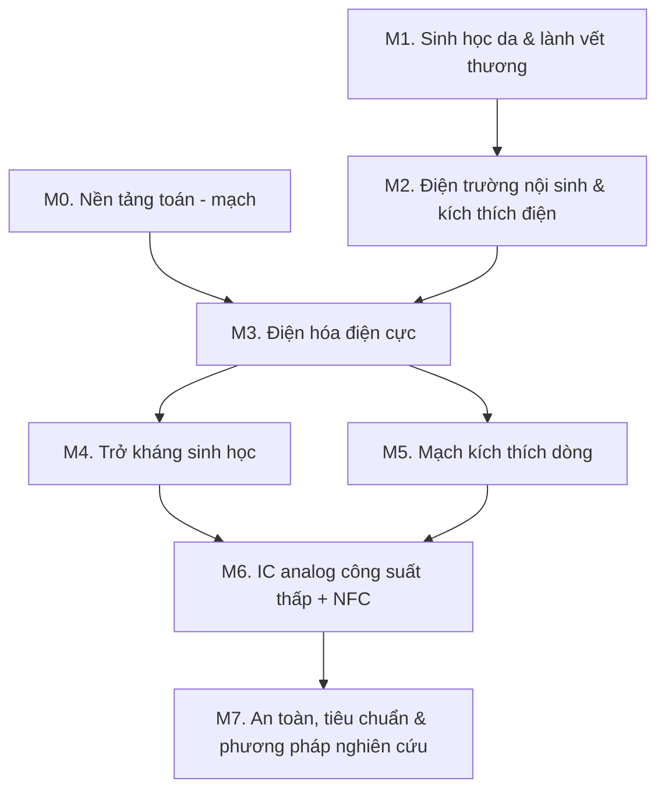

# Lý thuyết cần học: Băng dán vết thương thông minh dùng vi dòng
*Lộ trình cho sinh viên thiết kế vi mạch năm 2 (HCMUT), nền sinh học gần như bằng 0*

> **Cách dùng tài liệu này:** học theo thứ tự các module. Mỗi module có phần **"Cần hiểu"**, **tài liệu** và **câu hỏi tự kiểm tra**. Nếu trả lời được các câu hỏi thì chuyển sang module tiếp theo. Ký hiệu ⭐ là bắt buộc, ☆ là nâng cao, có thể học sau.

## Bản đồ kiến thức

| Module | Thời lượng gợi ý | Liên quan môn học ở trường |
| :--- | :--- | :--- |
| M0 Nền tảng | Đang học | Mạch điện, Tín hiệu & Hệ thống, Điện tử |
| M1 Sinh học | 2–3 tuần | (tự học) |
| M2 Điện sinh học vết thương | 2 tuần | (tự học) |
| M3 Điện hóa | 2–3 tuần | Hóa đại cương (ôn lại) |
| M4 Trở kháng sinh học | 3 tuần | Mạch điện (số phức), Xử lý tín hiệu số |
| M5 Mạch kích thích | 3–4 tuần | Điện tử, Mạch tương tự |
| M6 IC + NFC | Năm 3 | Vi mạch tương tự, CMOS VLSI, Thiết kế số |
| M7 An toàn & nghiên cứu | Học song song | Xác suất thống kê |

---

## M0. Nền tảng toán & mạch ⭐ (phần lớn đang học)
**Cần hiểu:**
- **Số phức và trở kháng**: $Z = R + jX$, biên độ và pha, giản đồ Bode, **giản đồ Nyquist** (dùng rất nhiều ở M3 và M4).
- **Mạch RC**: hằng số thời gian $\tau = RC$, đáp ứng xung vuông. Da và điện cực về bản chất là mạng RC.
- **Biến đổi Fourier / Laplace**: để hiểu đo trở kháng ở nhiều tần số.
- **Op-amp và MOSFET**: hồi tiếp âm, vùng bão hòa, gương dòng.

**Tự kiểm tra:**
1. Vẽ giản đồ Nyquist của mạch $R_1$ nối tiếp với $(R_2 \parallel C)$. Tại sao nó có hình bán nguyệt?
2. Cho xung dòng $100\,\mu\text{A}$, độ rộng $1\,\text{ms}$ đi vào tụ $1\,\mu\text{F}$. Điện áp trên tụ tăng bao nhiêu?

---

## M1. Sinh học da và quá trình lành vết thương ⭐
**Cần hiểu:**
- **Cấu trúc da**: biểu bì (epidermis), trong đó lớp sừng ngoài cùng có trở kháng rất cao; trung bì (dermis); mô dưới da. Các tế bào chính: **keratinocyte** (tế bào sừng), **fibroblast** (nguyên bào sợi), đại thực bào, tế bào nội mô mạch máu.
- **4 giai đoạn lành vết thương**:
  1. **Cầm máu** (vài phút đến vài giờ): tiểu cầu kết lại, hình thành cục máu đông.
  2. **Viêm** (1–6 ngày): bạch cầu và đại thực bào dọn vi khuẩn, mô chết.
  3. **Tăng sinh** (4–21 ngày): fibroblast tạo collagen, mạch máu mới mọc, keratinocyte bò vào phủ kín vết thương (tái biểu mô hóa).
  4. **Tái cấu trúc** (vài tuần đến 1 năm): collagen sắp xếp lại, hình thành sẹo.
- **Vết thương mạn tính** (loét do tiểu đường, loét tì đè, loét do suy tĩnh mạch): **bị "kẹt" ở giai đoạn viêm**, do tuần hoàn kém, nhiễm khuẩn hoặc màng sinh học vi khuẩn (biofilm), thiếu oxy.
- **Dấu hiệu nhiễm trùng đo được**: nhiệt độ tăng, pH thay đổi, dịch tiết nhiều, **trở kháng thay đổi**. Đây chính là những thứ băng dán thông minh cần đo.

**Tài liệu:**
- Khan Academy / Osmosis (YouTube): *"Wound healing"*, *"Skin anatomy"*.
- Bài tổng quan dễ đọc: Gurtner et al., *"Wound repair and regeneration"*, **Nature** 2008.

**Tự kiểm tra:**
1. Vì sao vết loét bàn chân của người tiểu đường lâu lành?
2. Tái biểu mô hóa thuộc giai đoạn nào, và do loại tế bào nào thực hiện?

---

## M2. Điện trường nội sinh và kích thích điện cho vết thương ⭐
*Đây là cơ sở khoa học cốt lõi của đề tài.*

**Cần hiểu:**
- **Pin da (skin battery)**: biểu bì bơm ion $\text{Na}^+$ vào trong, tạo **điện thế xuyên biểu bì khoảng 20–50 mV**.
- Khi da rách, chỗ vết thương bị "chập mạch". Dòng điện chảy ra phía vết thương, tạo một **điện trường ngang khoảng 100–200 mV/mm** ở mép vết thương.
- **Electrotaxis / galvanotaxis**: keratinocyte, fibroblast và đại thực bào **di chuyển có hướng theo điện trường**. Năm 2006, Zhao et al. (*Nature*) chứng minh đây là cơ chế phân tử thật (qua các protein PI3K và PTEN).
- **Mục tiêu của kích thích điện ngoài**: khôi phục hoặc khuếch đại điện trường nội sinh đã mất.
- **Các dạng kích thích dùng trong lâm sàng**:

| Dạng | Đặc điểm |
| :--- | :--- |
| LIDC (dòng một chiều cường độ thấp) | 20–1000 µA, gần với "vi dòng" nhất |
| HVPC (xung cao áp) | Xung đôi rất ngắn, điện áp 100–200 V, trung bình dòng thấp |
| Dòng xung hai pha | Cân bằng điện tích, an toàn cho da |

- Thông số quan trọng: **mật độ dòng ($\text{A/m}^2$)**, **cực tính** (cực âm hay cực dương đặt ở vết thương), **thời gian mỗi ngày**, **số tuần điều trị**.

**Tài liệu (đọc theo thứ tự):**
1. ⭐ McCaig et al., *"Controlling cell behavior electrically: current views and future potential"*, **Physiological Reviews** 2005.
2. ⭐ Zhao et al., *"Electrical signals control wound healing through PI3Kγ and PTEN"*, **Nature** 2006.
3. ⭐ Kloth, *"Electrical stimulation for wound healing: a review of evidence from in vitro studies, animal experiments, and clinical trials"*, **Int. J. Lower Extremity Wounds** 2005.
4. ⭐ **Bài mục tiêu**: Jiang et al., *"Wireless, closed-loop, smart bandage with integrated sensors and stimulators for advanced wound care and accelerated healing"*, **Nature Biotechnology** 2023 (nhóm Stanford).

**Tự kiểm tra:**
1. Giải thích "pin da" bằng sơ đồ mạch tương đương (nguồn áp + điện trở).
2. Vì sao điện trường ở mép vết thương lớn hơn rất nhiều so với điện trường mà vi dòng từ điện cực tạo ra trong mô sâu?
3. Bài Stanford đo những đại lượng nào và kích thích ra sao?

---

## M3. Điện hóa giao diện điện cực–mô ⭐
**Cần hiểu:**
- Trong dây dẫn hạt mang điện là electron, trong mô là ion. **Ở điện cực, hai loại dòng này phải chuyển đổi cho nhau.**
- **Lớp điện kép (double layer)**: hoạt động như một tụ điện. Ở mức điện tích nhỏ, dòng chỉ nạp/xả tụ này (**cơ chế điện dung**, an toàn).
- **Phản ứng Faraday**: khi điện áp vượt ngưỡng sẽ xảy ra điện phân nước, sinh khí $\text{H}_2/\text{O}_2$, **đổi pH**, ăn mòn điện cực và **tổn thương mô**.
- **Cửa sổ nước (water window)** và **giới hạn bơm điện tích (charge injection limit)** của từng vật liệu: Pt, Ag/AgCl, IrOx, PEDOT:PSS, hydrogel dẫn điện.
- **Mô hình Randles**: $R_{\text{dung dịch}}$ nối tiếp với $(C_{\text{lớp kép}} \parallel R_{\text{chuyển điện tích}})$. Đây là mô hình điện cực đưa vào mô phỏng SPICE.
- **CPE (constant phase element)** mô tả lớp kép chính xác hơn tụ lý tưởng.
- **Cân bằng điện tích**: pha dương và pha âm phải có điện tích bằng nhau, cộng thêm tụ chặn DC và chập xả điện cực sau mỗi xung.

**Tài liệu:**
1. ⭐ Merrill, Bikson & Jefferys, *"Electrical stimulation of excitable tissue: design of efficacious and safe protocols"*, **J. Neurosci. Methods** 2005.
2. ☆ Cogan, *"Neural stimulation and recording electrodes"*, **Annu. Rev. Biomed. Eng.** 2008.

**Tự kiểm tra:**
1. Vì sao xung một pha (monophasic) kéo dài gây hại cho da và điện cực?
2. Vẽ mô hình Randles. Khi tần số tiến tới 0 và tới vô cùng, trở kháng của mô hình này tiến tới đâu?
3. Điện cực Ag/AgCl khác điện cực Pt như thế nào về cơ chế dẫn dòng?

---

## M4. Trở kháng sinh học (Bioimpedance) ⭐
**Cần hiểu:**
- **Tính chất điện của mô**: ở tần số thấp, dòng chỉ chảy vòng qua dịch ngoài tế bào (màng tế bào chặn lại). Ở tần số cao, dòng xuyên qua màng tế bào.
- **Mô hình Cole**: $R_\infty, R_0, \tau, \alpha$. Trên giản đồ Nyquist là một cung tròn bị dẹt.
- **Đo 2 điện cực và 4 điện cực**: vì sao cấu hình 4 điện cực loại bỏ được trở kháng tiếp xúc.
- **Kỹ thuật đo**:
  - Kích thích bằng sóng sin dòng, giữ dòng nhỏ để an toàn (thường $\le$ vài chục µA).
  - **Giải điều chế I/Q** (đồng bộ / lock-in) để tách biên độ và pha.
  - **Phổ trở kháng** (EIS): quét nhiều tần số.
- **Ý nghĩa với vết thương**: mô lành/biểu mô hóa và mô nhiễm trùng/phù nề có trở kháng khác nhau.

**Tài liệu:**
1. ⭐ Sách: Grimnes & Martinsen, ***Bioimpedance and Bioelectricity Basics*** (Academic Press) — các chương 1–3 và 7.
2. ☆ Datasheet và app note của **AD5940/AD5941** (Analog Devices).

**Tự kiểm tra:**
1. Vì sao trở kháng mô giảm khi tần số tăng?
2. Vẽ sơ đồ khối giải điều chế I/Q để đo biên độ và pha của một trở kháng chưa biết.

---

## M5. Mạch tạo kích thích dòng ⭐
**Cần hiểu:**
- **Nguồn dòng**: dòng lý tưởng và dòng thực tế, **trở kháng ra** $R_{\text{out}}$, **điện áp tuân thủ** (compliance voltage).
- Các topo: Howland, op-amp + MOSFET + $R_{\text{sense}}$, **gương dòng cascode** (topo dùng trên chip).
- **DAC dòng**: loại trọng số nhị phân và loại thermometer; khái niệm INL/DNL; ảnh hưởng của sai lệch (mismatch) giữa các transistor.
- **Tạo xung hai pha**: dùng cầu H, hoặc cặp nguồn đẩy dòng + nguồn hút dòng.
- **Các kỹ thuật cân bằng điện tích**: chập điện cực sau xung, dùng tụ chặn, đo điện áp dư rồi bù vào xung sau (closed-loop charge balancing).
- **Theo dõi điện áp điện cực** để phát hiện hở mạch hoặc đoản mạch.

**Tài liệu:**
1. ⭐ Razavi, ***Design of Analog CMOS Integrated Circuits***, các chương về gương dòng và op-amp.
2. ⭐ Tìm trên IEEE Xplore với từ khóa: `"biphasic current stimulator" charge balancing`, `"wound healing" stimulator IC`.

**Tự kiểm tra:**
1. $R_{\text{out}}$ của một gương dòng cascode xấp xỉ bằng bao nhiêu (theo $g_m$ và $r_o$)?
2. Với dòng $100\,\mu\text{A}$ và tải $30\,\text{k}\Omega$, cần điện áp tuân thủ tối thiểu bao nhiêu? Nếu nguồn là $3.3\,\text{V}$ thì phải làm gì?

**Thực hành:** mô phỏng LTspice nguồn dòng hai pha + mô hình Randles (M3) + mô hình da, và quan sát điện áp dư trên điện cực.

---

## M6. IC analog công suất thấp và năng lượng không dây ☆ (năm 3)
**Cần hiểu:**
- **Nguồn tham chiếu**: bandgap, nguồn dòng PTAT; transistor ở **vùng dưới ngưỡng (subthreshold)** để tiết kiệm năng lượng.
- **Op-amp/OTA công suất thấp**, bộ so sánh, **ADC SAR** (để đọc kết quả đo trở kháng).
- **Năng lượng không dây qua NFC (13.56 MHz)**:
  - Ghép cảm ứng giữa hai cuộn dây, mạch cộng hưởng LC, hệ số ghép $k$.
  - **Mạch chỉnh lưu** trên chip, **LDO**, điều chế tải để gửi dữ liệu ngược về điện thoại.
  - Các chuẩn ISO 14443 / ISO 15693.
- **Khối số**: máy trạng thái (FSM) tạo xung, thanh ghi điều khiển, viết bằng Verilog.
- **Quy trình thiết kế IC mã nguồn mở**: Xschem → ngspice → Magic/KLayout → DRC/LVS → PEX, dùng PDK SKY130 hoặc GF180.

**Tài liệu:**
1. ⭐ Sarpeshkar, ***Ultra Low Power Bioelectronics*** (Cambridge).
2. ⭐ Baker, ***CMOS Circuit Design, Layout, and Simulation***.
3. ☆ Khóa học trực tuyến: *Zero to ASIC*, tài liệu Tiny Tapeout, bài giảng Razavi trên YouTube.

---

## M7. An toàn, tiêu chuẩn và phương pháp nghiên cứu ⭐ (học song song)
**Cần hiểu:**
- **Tiêu chuẩn**:
  - IEC 60601-1: an toàn điện chung cho thiết bị y tế.
  - IEC 60601-2-10: riêng cho máy kích thích thần kinh–cơ.
  - ISO 10993: tương thích sinh học của vật liệu tiếp xúc da.
- **Đạo đức nghiên cứu**: thử nghiệm trên người hoặc động vật bắt buộc phải qua hội đồng đạo đức. Sinh viên làm việc với **tải giả** và **mô hình gel/phantom**.
- **Phương pháp nghiên cứu**: đọc bài báo theo thứ tự abstract → hình → kết luận → phương pháp; viết tổng quan tài liệu; xác định khoảng trống nghiên cứu (research gap); thống kê cơ bản (trung bình, độ lệch chuẩn, sai số đo, kiểm định t).
- **Công cụ**: Zotero, Google Scholar, IEEE Xplore.

---

## Kế hoạch 12 tuần đầu tiên (gợi ý)

| Tuần | Học | Làm |
| :--- | :--- | :--- |
| 1–2 | M1: da, lành vết thương | Tóm tắt 1 trang bằng lời của bản thân |
| 3–4 | M2: McCaig, Zhao 2006 | Đọc bài Stanford 2023, vẽ lại sơ đồ khối hệ thống |
| 5–7 | M3: Merrill 2005 | Mô phỏng mô hình Randles trong LTspice |
| 8–10 | M4: Grimnes chương 1–3 | Mô phỏng đo trở kháng bằng I/Q trong LTspice/Python |
| 11–12 | M5: nguồn dòng | Lắp mạch nguồn dòng 2 pha trên breadboard + tải giả |
